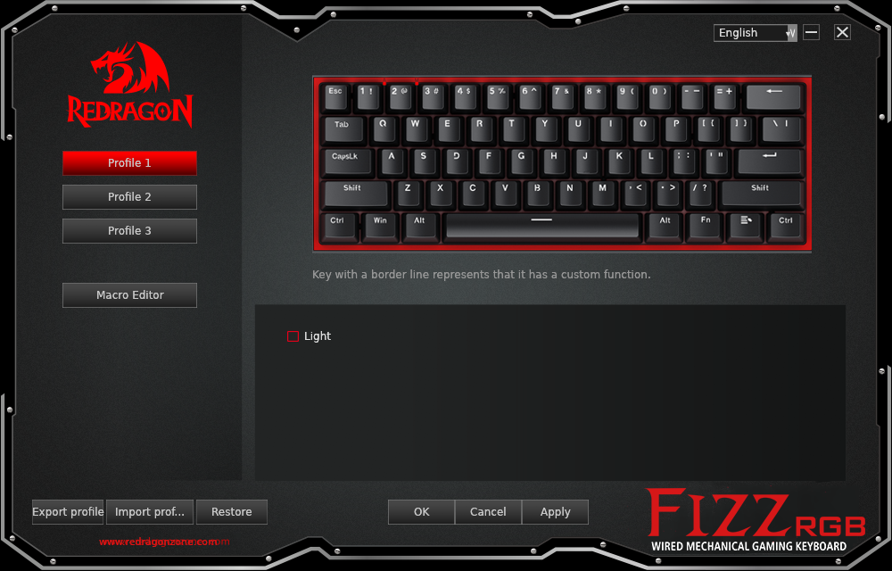
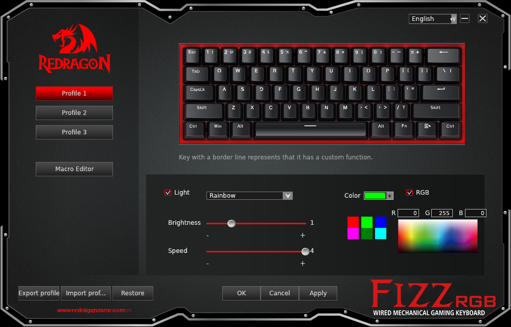
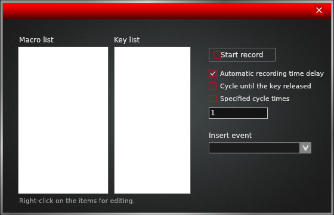
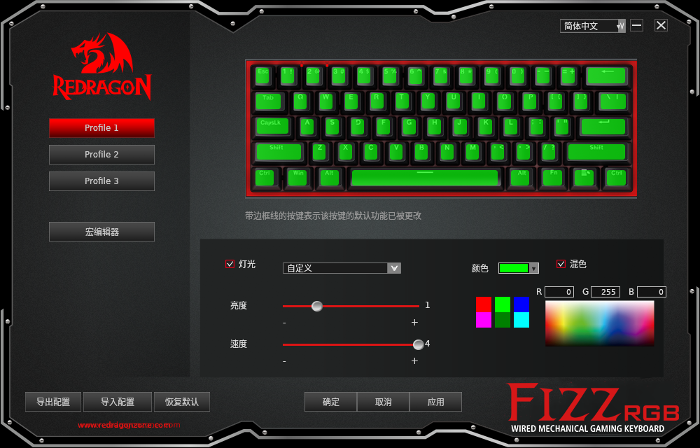

# redragon-k617

Linux userspace driver for the **Redragon K617 RGB** (USB `258a:0049`, BY Tech /
Sinowealth SH68F90A). It replaces the vendor's Windows-only setup with a Rust
CLI and a skinned GUI that speak the same HID feature reports as the official
software.

This is a port of the vendor app's device layer, not a generic RGB daemon: the
22 firmware effects, base colour, speed, brightness and JSON profiles use the
packet formats recovered from `KeyboardDrv.exe` 1.6.6 (the installer in the
parent directory). Per-key colour is supported only through the vendor's
`06 09` LED-matrix blocks, which are still being decoded; the non-vendor
report-8 shortcut is kept behind an explicit unsafe flag because it can reset
some K617 firmware revisions.

## Status

| Feature | Status |
| --- | --- |
| Device detection (interface 1, usage page `0xFF00`) | done |
| Password / handshake (`0x81`) | done |
| 22 firmware effects | done |
| Base colour, speed, brightness | done |
| Read committed state | done |
| Per-key colour (61 keys) | preview-only; vendor `06 09` colour groups not fully decoded |
| Non-vendor report-8 per-key frames | opt-in with `--unsafe-per-key`; can reset some firmware |
| Saved profiles | done (JSON, not the vendor `.pro` format) |
| 1:1 skinned GUI (1000x640 main window + Light panel + Macro Editor) | done |
| GUI language switch (English / Simplified Chinese) | done |
| Macro editor (local JSON macros, recording, folders) | done, device upload not yet |
| Key remapping | not yet (protocol captured, frame semantics still unknown) |
| Firmware update | intentionally not implemented |

The GUI reproduces the vendor layout from `Cfg.ini` (`rcKB`, `rcLED`,
`ptProfile`, `ptMacro`, `ptApplyBtn`) and from the running 1.6.6 app under
Wine. It uses the original skin PNGs, so the chrome, keyboard preview and
control positions match the Windows software.

## Build and install

### Local install (no root)

```sh
./install-local.sh
```

This builds both binaries, installs them under `~/.local/bin`, generates the
desktop entry with absolute `Exec`/`TryExec` paths, installs the icon and
refreshes the desktop/icon caches. The absolute paths matter: application
launchers do not reliably inherit the shell `PATH`, so an entry that only says
`Exec=redragon-k617-gui` can silently do nothing when the binary is in
`~/.local/bin`.

### System install

```sh
cargo build --release
sudo install -Dm755 target/release/redragon-k617 /usr/local/bin/redragon-k617
sudo install -Dm755 target/release/redragon-k617-gui /usr/local/bin/redragon-k617-gui
sudo install -Dm644 udev/99-redragon-k617.rules /etc/udev/rules.d/99-redragon-k617.rules
sudo install -Dm644 desktop/redragon-k617.desktop /usr/share/applications/redragon-k617.desktop
sudo install -Dm644 assets/gui/appico.png /usr/share/icons/hicolor/256x256/apps/redragon-k617.png
sudo update-desktop-database /usr/share/applications 2>/dev/null || true
sudo gtk-update-icon-cache -f -t /usr/share/icons/hicolor 2>/dev/null || true
sudo udevadm control --reload-rules
sudo udevadm trigger
```

Replug the keyboard, then check the device:

```sh
redragon-k617 info
```

`info` prints the hidraw path, the six-byte device password and the committed
effect. If the device is not found, confirm that `lsusb` shows `258a:0049` and
that the udev rule grants access to the hidraw node. On systems without
systemd-logind `uaccess`, replace the `TAG+="uaccess"` part with
`MODE="0660", GROUP="input"` and make sure your user is in the `input` group.

## GUI



Launch it with `redragon-k617-gui` (or the desktop entry). The window is the
same 1000x640 skinned canvas as the vendor app:

- three profile buttons on the left, with the selected profile in red;
- the 560x212 keyboard preview with clickable keys;
- the collapsible Light panel with the 22 LED modes, RGB colour picker,
  presets, brightness and speed sliders;
- Export/Import/Restore, OK/Cancel/Apply and the language dropdown;
- a separate 560x360 Macro Editor window (macro list, key/event list, record
  controls, cycle options, insert-event menu).



The Light panel and keyboard preview are live: selecting a mode or dragging a
slider sends the same five-frame burst as the Windows app, and the profile
buttons switch between three independent saved profiles. The palette matches
the vendor 3x3 swatches (including dark green, cyan, yellow, orange and white).

Self-define is safe again: the GUI now sends only the vendor five-frame burst.
It does not send the non-vendor report-8 per-key frame, which was observed to
reset the keyboard when the base colour changed to some palette values. The
preview still shows a per-key map, but clicking a key in Self-define mode only
selects it and shows a "preview-only" warning; the keyboard keeps its current
vendor colour-group matrix.

Because the vendor's Self-define colour groups are not decoded yet, choosing a
static palette colour or using the colour picker while Self-define is selected
switches the effect to Fixed-on. Fixed-on is the firmware's real solid-colour
mode, so the keyboard changes immediately and stays connected.



The Macro Editor stores macros in `~/.config/redragon-k617/macros.json`. It can
record keys while the editor window has focus and edit the event list. Uploading
a macro to the keyboard is not implemented yet (the vendor macro frame format is
still being decoded); the editor is otherwise usable as a local macro manager.



The language dropdown switches the same labels used by the vendor
`Text/en` and `Text/sc` files. English is the fallback when a Chinese key is
missing.

GUI gaps, kept explicit so they do not look like finished features:

- the Key assignment page (media keys, macro binding, disable) is not ported;
- the vendor Self-define colour-group editor (Define1..5, per-group colours)
  is not fully decoded yet, so per-key colours stay preview-only for now;
  static colours use Fixed-on until that format is implemented;
- the tray icon, hotplug watcher and native file dialogs are not implemented;
- macro upload to the keyboard and firmware update are not implemented;
- the vendor `.pro` profile format is not decoded (JSON is used instead).

## CLI usage

```sh
# 22 firmware effects
redragon-k617 effects
redragon-k617 effect rainbow
redragon-k617 effect sine-wave --color 00ff00 --speed 3 --brightness 2
redragon-k617 effect retro-snake --color 3366ff

# brightness and speed modify the current profile
redragon-k617 brightness 1
redragon-k617 speed 4

# solid colour: safe Fixed-on effect, no report-8 frame
redragon-k617 solid ff0000

# per-key colour is opt-in because report 8 can reset some firmware
redragon-k617 paint W=00ff00 Space=0000ff A=ffff00 --base 111111 --unsafe-per-key

# turn the lighting off
redragon-k617 off

# profiles
redragon-k617 profile save gaming
redragon-k617 profile list
redragon-k617 profile load gaming
redragon-k617 profile show
redragon-k617 profile delete gaming
```

Colours accept `RRGGBB`, `#RRGGBB`, `0xRRGGBB`, `r,g,b` and the names `red`,
`green`, `blue`, `white`, `yellow`, `cyan`, `magenta`, `orange`, `black`.

Key names are the US ANSI names (`Escape`, `Tab`, `CapsLock`, `LShift`, `LCtrl`,
`Space`, `Enter`, `Backspace`, `LBracket`, ...). `redragon-k617 keys` prints
all 61. Short forms such as `Esc`, `Ctrl`, `Win`, `Return`, `;` and `[` work
too.

`solid` uses the firmware Fixed-on mode, which is the safe way to get one
colour across the keyboard. Per-key colours use the non-vendor report-8 frame
and are therefore opt-in: `--unsafe-per-key` must be passed explicitly, because
on the tested K617 firmware some base colours reset the keyboard when report 8
is used. The official app does not send report 8 at all; it writes `06 09` LED
matrix blocks for its colour groups. That vendor format is documented as a
remaining gap, not silently replaced by the unsafe path.

Loading a saved profile with per-key entries prints a warning and applies only
the safe firmware burst unless `--unsafe-per-key` is passed. The firmware effect
itself is committed to the keyboard's flash, so it survives a reboot; the
report-8 overlay is host-side state and is not re-applied automatically.

Use `--dry-run` before a command to print the frames without touching the
keyboard:

```sh
redragon-k617 --dry-run effect sine-wave --color 00ff00
```

## Pulsing red wave (experimental)

```sh
# 10 second demo, then restore the previous effect
redragon-k617 snake

# run until Ctrl+C
redragon-k617 snake --seconds 0

# slower or faster wave
redragon-k617 snake --speed 1.8
```

The effect is a thick red two-hump standing wave. It uses the real key centres
from `Cfg.ini` and normalises against the leftmost and rightmost key centres, so
it stays centred and includes the spacebar, Escape, left Ctrl and right Ctrl. At one phase the two inner humps touch the top while the centre
and the two ends touch the bottom; at the opposite phase it flips. A quadrature
single-arch term keeps the shape continuously rolling, so it never pauses on a
flat line and never stops at the extremes. Every key outside the band stays
off. The band edge has a small smooth thickness
variation so it looks slightly distressed instead of laser-cut.

`--speed` is in radians per second and accepts high values (up to 120) for a
very fast wave. `--fps 30` or `--fps 60` looks smoother than 15.

This command streams report-8 per-key frames, which is the non-vendor path.
Report 8 can reset some K617 firmware revisions. It is deliberately a separate
explicit command, not part of the safe GUI or default effect paths. Keep the
first runs short and unplug/replug the keyboard if it disappears.

## How it works

The keyboard exposes a vendor HID interface (interface 1, usage page `0xFF00`,
usage `0x0001`) with four report IDs:

| Report | Length | Purpose |
| --- | --- | --- |
| `0x03` | 3 bytes | status/input from the keyboard |
| `0x05` | 6 bytes | handshake and short commands |
| `0x06` | 1032 bytes | 8-byte block header + 1024-byte payload |
| `0x08` | 382 bytes | direct per-key LED frame (non-vendor, unsafe on some firmware) |

An effect change is a five-frame burst:

```text
05 83 b6 00 00 00                 handshake
06 08 b8 00 40 ... | profile      base colour at offsets 29..31
06 09 00 00 40 ... | matrix       LED matrix block
06 09 00 00 40 ... | matrix       second matrix block
06 03 b6 00 40? ...| commit       effect index at byte 21, speed/brightness at 69/71
```

The firmware generates the animation; the host only supplies the effect index,
base colour and a packed speed/brightness nibble. The official app implements
Self-define with `06 09` LED-matrix blocks and five colour groups (Define1..5),
not report 8. The Sinodragon frame (`08 0a 7a 01` + 96 RGB slots, column-major)
is kept as an opt-in experiment because it is simple and works on some K617
units, but it is not the vendor path and can reset others.

The full packet layout, including the emulation harness used to recover it, is
documented in [`docs/PROTOCOL.md`](docs/PROTOCOL.md).

## Safety

- Only HID feature reports are used. The tool never enters the bootloader and
  never issues a firmware/flash command.
- The vendor app sends some oversized Windows buffers that hidraw rejects; the
  port always sends exactly the report length. A 9-byte write to report 5 will
  make the keyboard disconnect until it re-enumerates, which is why the sizes
  here are strict.
- `redragon-k617 info` is safe to run at any time.
- Do not use `--unsafe-per-key` on a keyboard that has not been tested with
  report 8. On the tested unit, changing the Self-define base colour with
  report 8 reset the USB device and made it stop responding until it
  re-enumerated. The default paths never send report 8.

## Verification

The implementation was checked against real K617 hardware:

- password query returns `02 00 00 00 00 1a`;
- every effect index 1..22 is accepted and echoed back by the state read;
- speed/brightness nibbles are echoed back at commit offsets 69/71;
- the vendor `06 09` block layout was captured from the official app under
  Wine; the app does not use report 8 for Self-define;
- report 8 was reproduced as the cause of the disconnect: a burst-only
  Self-define update with dark green and cyan stays connected, while the old
  burst-plus-report-8 path reset the device on the tested firmware;
- the GUI main window, Light panel and Macro Editor were compared against the
  official 1.6.6 app running under Wine (screenshots in `docs/screenshots/`),
  and the GUI controls were used to switch effects, change speed/brightness,
  the dark-green, cyan and white palette entries (the path that used to reset
  the keyboard) and save profiles on the real keyboard.

Build checks:

```sh
cargo test
cargo clippy --all-targets -- -D warnings
cargo fmt --check
```

## License

The source code is MIT licensed. See `LICENSE`.

The vendor skin PNGs and translation XMLs under `assets/gui` are from the
official Redragon K617 1.6.6 package and remain the property of their owner.
They are included only for interoperability with hardware the user owns; see
`NOTICE`. The bundled DejaVu Sans font is covered by
`assets/gui/DejaVu-LICENSE.txt`.
